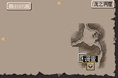
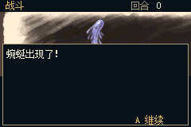
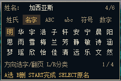
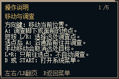

# 废都物语 GBA 移植原型

把《Ruina 废都物语》的原始事件数据与规则接到原生 GBA 运行时的实验工程。供爱好者参考、修改与继续完善。

[v0.7.3 下载：工程与试玩 ROM](https://github.com/shiyi1133/Ruina-GBA/releases/tag/v0.7.3)

解压合集后，`试玩/` 中的 `.gba` 可直接用 GBA 模拟器打开；`工程/` 是与它匹配的源码和转换资源。
这版包含完整游戏数据，可继续游玩，支持普通 SAV；**全流程、全部结局和实机尚未验收**。




## v0.7.3：战斗动画性能优化

- 缓存动画记录、加快局部解码与透明特效绘制，保持原有图案、帧序与颜色。
- 同一组 213 个原动画帧逐像素比较一致，绘制平均耗时约减少 37%；这项指标不是游戏平均帧率。
- 带原音效和简化 MIDI 的四段完整播放合计约减少 14%，其中复杂大特效约从 25.8 秒降到 20.5 秒；仍可能慢于 PC。
- 准备动画背景时分段补充音乐缓冲，四段播放样例未检测到音乐缓冲耗尽。
- 普通版和验收增强版均提供；SAV 格式保持 v5。最新专项范围见 `evidence/animation_optimization_20261023/validation.json`。

## v0.7.2：恢复战斗动画

- 根据原版帧数据绘制攻击、魔法与治疗特效，保留定时音效、缩放、色调、透明度、目标及全屏闪光。
- 230 条记录中 213 条带图像，600 个有效图案的 RGB555 颜色和透明区域已逐个核对原素材。
- 普通版与高属性、全魔法验收版分开提供，普通 SAV 格式不变。
- 复杂大特效仍可能明显慢于 PC；地图事件动画、震动和场景切换继续采用已有简化。
- 本次测试范围见 `evidence/battle_animations_20261023/validation.json`；不能代替完整通关或实机验收。

## v0.7.1：取名与操作说明

- 取名支持 30 个常见姓、100 个名字用字、大小写英文字母、29 个符号和数字，可混合输入六个字符。
- L/R 切换分类，方向键选字并跨页；A 添加、B 删除、SELECT 还原、START 完成。
- 地图按 B（或 START）打开菜单，选择“操作说明”。五页说明支持左右或 L/R 翻页，B 返回菜单。
- 本次实测覆盖全部候选字形、分页、混合姓名存读档、四种出身开场、首战及战斗菜单返回。
- v0.7 的画质、地图、音乐、游戏数据和 SAV 格式沿用；本次没有重新运行全部整曲专项。




## v0.7 的画面与性能改进

- 地图和人物保留原尺寸，通过滚动查看；光标、边缘箭头、文字与地图分层。
- 头像保留独立 RGB555 颜色；插图与战斗适配 240×160，部分原动画简化为切换。
- 菜单只更新变化的区域。战斗支持逐级 B 返回并保留上级选择，取消不消耗资源。
- 游戏与音乐欣赏均用简化音色，游戏过程中进一步简化。
- 剧情、技能数值、物品、配方、敌人与奖励数据保持原包内容。

这是有选择的 RM2000 兼容运行时，**并非完整 EasyRPG Player 的 GBA 移植**。颜色、分辨率与部分演出仍受 GBA 限制。

## 构建

已验证 Linux/WSL + Python 3 + GNU Arm Embedded 13.2.1：

```sh
python3 tools/build.py --incremental
```

输出为 `build/废都物语_GBA_开篇开发验证版.gba`。可通过 `ARM_TOOLCHAIN_PREFIX` 指定 `arm-none-eabi-` 前缀。
已转换资源随工程提供，正常重建不需要原 ZIP、系统字体或 Python 图像库。Windows 原生构建尚未验证。

重新转换素材时设置 `RUINA_SOURCE_ARCHIVE`、`RUINA_FONT`，并安装 Pillow/NumPy。详细操作见 `工程使用说明.txt` 与 `README.txt`。

## 工程入口与验证

- `runtime/rm2k/`：事件、战斗、地图、物品、存档等共用逻辑。
- `platform/gba/`：GBA 显示、音频、按键与存储。
- `source/`：本作启动、特殊列表和音乐欣赏。
- `build/`：保留的转换资源；编译产物由构建命令生成。
- `tools/check_common_names.py`、`tools/check_controls_help.py`：本次取名与说明专测；需外部 mGBA 开发库、C 编译器和图像库。
- `evidence/ui_v071/current_validation.json`：本次实际检查汇总；v0.7 的广泛专项保持原哈希记录。
- `tools/validate_balanced.py`：原有广泛验证入口。
- `evidence/`：各版真实测试结果，包含失败、拒绝和未运行记录；请核对报告中的 ROM SHA-256。

发行包的源码 ZIP 已新解压重建，并与试玩 ROM 逐字节核对。模拟器抽查覆盖四种出身、首战、第一 CP、菜单返回、普通存档恢复和画面/声音专项，不能代替完整通关。

## 来源和许可

引擎及工具采用 GPL-3.0-or-later；上游代码及许可见 `third_party/`、`sources.lock.json` 与 `LICENSE`。
原游戏素材及汉化、修复内容保留各自权利归属。完整来源和署名见 `CREDITS.txt`。
